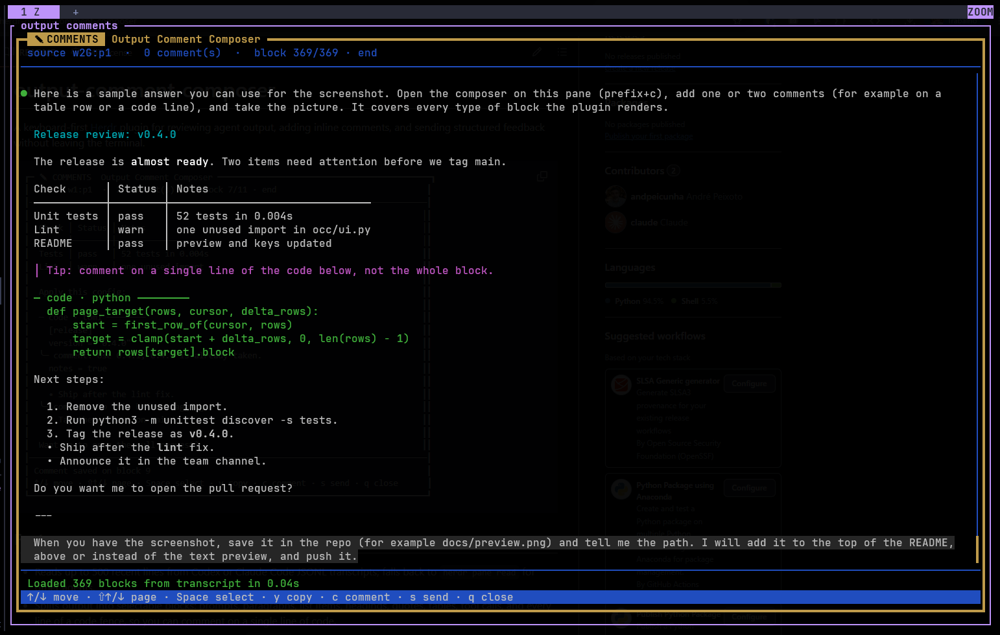
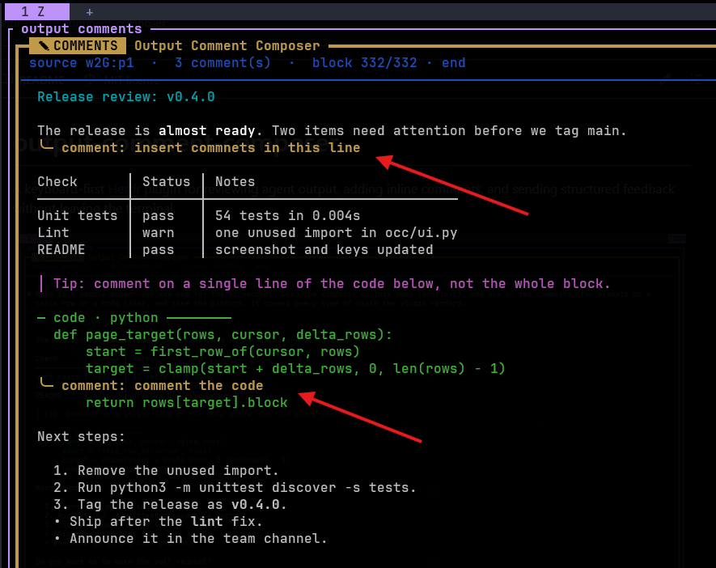
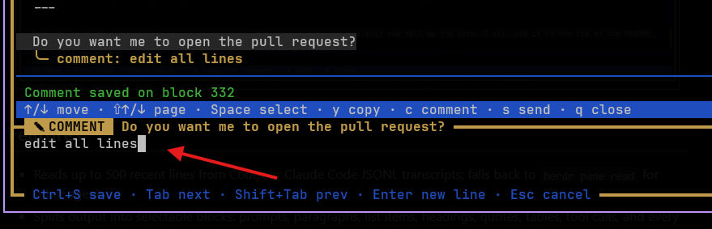

# output-comment-composer

A keyboard-first [Herdr](https://herdr.io) plugin for reviewing agent output,
adding inline comments, and sending structured feedback without leaving the
terminal.

Plugin site: [Output Comment Composer](https://portfolio-andrepeixoto.vercel.app/herdr-comment).



## Features

- Reads up to 500 recent lines from Codex or Claude Code JSONL transcripts;
  falls back to `herdr pane read` for other agents.
- Splits output into selectable blocks: prompts, paragraphs, list items,
  headings, quotes, tables, tool calls, and every line of a code fence, so you
  can comment on a single line of code.
- Renders Markdown the way the agent UIs do: `**bold**` as bold, tables with
  aligned columns (wide cells are truncated), and code fences with a
  `─ code · lang ─` marker.
- Opens a comment box for the current block; multiline comments, `Tab` to jump
  to the next block while typing, and a confirmation before discarding a draft.
- Shows a scrollbar and a `top` / `NN%` / `end` position, with page navigation
  on `Shift+↑` / `Shift+↓`.
- Copies one or more blocks through OSC 52, keeping code lines intact.
- Sends all comments to the source agent as one structured prompt.
- Uses Python's built-in `curses`; no Python package installation is needed.

## Requirements

- [Herdr](https://herdr.io) 0.9.5 or newer.
- Python 3 with `curses` support.
- `jq` for the Herdr pane launcher.

## Installation

```sh
herdr plugin install andpeicunha/herdr-output-comment-composer
```

## Usage

Bind the `toggle` action in your Herdr configuration:

```toml
[[keys.command]]
key = "prefix+c"
type = "plugin_action"
command = "andpeicunha.output-comment-composer.toggle"
description = "output-comment-composer: toggle"
```

### Commenting

Move to a block and press `c` to comment on it. Comments appear under the
block, or the single code line, they refer to:



### Keys

While navigating:

| Key | Action |
| --- | --- |
| `↑` / `k` | Previous block |
| `↓` / `j` | Next block |
| `Shift+↑` / `Shift+↓` | Move a full page up / down |
| `u` / `Page Up` | Move half a page up |
| `d` / `Page Down` | Move half a page down |
| `g` / `G` | First / last block |
| `c` | Open the comment box for the current block |
| `Space` | Start or finish a multi-block selection |
| `y` | Copy the selected blocks through OSC 52 |
| `s` | Send all comments to the source agent |
| `q` / `Esc` | Close the composer |

While the comment box is open:



| Key | Action |
| --- | --- |
| `Enter` | New line |
| `Tab` / `Shift+Tab` | Save and keep typing on the next / previous block |
| `Ctrl+S` | Save the comment and close the box |
| `Ctrl+U` | Clear the current line |
| `Esc` | Cancel; asks before discarding changes |

Use your terminal's paste shortcut, usually `Ctrl+Shift+V`, inside the comment
box.

### Settings

Put settings in `config.env` inside the plugin config directory:

```sh
cd "$(herdr plugin config-dir andpeicunha.output-comment-composer)"
printf 'OCC_SIGNATURE=@your-handle\nOCC_MAX_LINES=800\n' > config.env
```

The file is read each time the composer opens and survives plugin updates.
An environment variable with the same name, set where Herdr runs, overrides it.

| Setting | Default | Effect |
| --- | --- | --- |
| `OCC_MAX_LINES` | `500` | Transcript lines to load |
| `OCC_SIGNATURE` | unset | Signature line appended to the sent prompt, e.g. `@your-handle` |

Runtime files (per-workspace pane metadata and `crash.log`) live in the plugin
state directory. Launcher errors appear in
`herdr plugin log list --plugin andpeicunha.output-comment-composer`.

## What gets sent

`s` sends one prompt to the source agent. Each comment names its block and
quotes the commented text. For example:

```
Please address these comments on your previous output:

Comment 1 on block 7:

> version = "0.4.0"

Comment:
Use 0.4.1, 0.4.0 is already taken.

Comment 2 on block 9:

> - Ship after the **lint** fix.

Comment:
Do this before tagging.

— @your-handle
```

The signature line only appears when `OCC_SIGNATURE` is set (see [Settings](#settings)).

## How it works

1. The plugin reads the current agent session metadata from Herdr.
2. Codex and Claude Code sessions are loaded from their local JSONL transcripts.
3. Recent content is split into semantic Markdown blocks and shown in a zoomed
   `curses` pane.
4. Comments stay in memory until `s` sends a structured prompt through Herdr.

The plugin does not call an external API. The configured agent may have its own
network access after it receives the feedback prompt.

## Supported sources

| Agent | Source |
| --- | --- |
| Codex | `$CODEX_HOME/sessions/**/*.jsonl` (default `~/.codex`) |
| Claude Code | `$CLAUDE_CONFIG_DIR/projects/*/*.jsonl` (default `~/.claude`) |
| Other agents | Last 200 lines from `herdr pane read` |

## Development

```sh
python3 -m unittest discover -s tests -v
```

Project layout:

| Path | Contents |
| --- | --- |
| `output_comment_composer.py` | Entry point started by `bin/output-comment-composer` |
| `occ/transcript.py` | Codex and Claude JSONL transcript loading |
| `occ/markdown.py` | Block grouping, inline Markdown, tables, and code fences |
| `occ/layout.py` | Display rows, paging, and scrollbar math |
| `occ/editor.py` | `TextBuffer`, the comment editor's text model |
| `occ/herdr_io.py` | Herdr pane reads, clipboard copy, and prompt sending |
| `occ/settings.py` | Settings from the environment and `config.env` |
| `occ/ui.py` | The `curses` interface |

For local testing:

```sh
herdr plugin link .
```
